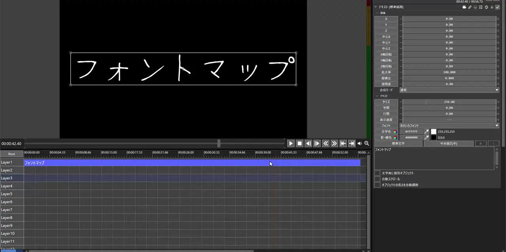

# FontMap

## 概要

フォントを、グリフの形が似ているもの同士が近くに来るように2次元の地図に並べ、地図から選んで設定するAviUtl2の汎用プラグインです。

オブジェクト設定の「フォント」ボタンのメニューの代わりに地図が開き、形の似たフォントを見比べながら選べます。

## 導入方法

1. [リリース](../../releases)から `FontMap.au2pkg.zip` をダウンロードし、AviUtl2のプレビューウィンドウにドラッグ&ドロップします。
   - 手で置く場合は、アプリケーションデータフォルダ内に `Plugin\FontMap\FontMap.aux2` となるように置きます。
2. AviUtl2を起動します。
3. テキストオブジェクトの設定の「フォント」ボタンを押すと地図が開きます。
   - 初めて開いた時は、全てのフォントの形を解析して地図を作ります(フォントの数によって数秒〜数十秒かかります)。

### 削除方法

1. AviUtl2を終了します。
2. アプリケーションデータフォルダ内の `Plugin\FontMap` フォルダを削除します。

(パッケージのアンインストールでも削除できますが、解析の結果・地図・設定のファイルは残ります。不要な場合は `Plugin\FontMap` フォルダを削除してください)

## 機能

### 地図を開く場所

次のどこからでも地図を開けます。

| 場所 | 内容 |
| --- | --- |
| オブジェクト設定の「フォント」ボタン | フォントのメニューの代わりに地図を開きます。メニューにあるフォントだけを地図に載せます |
| フォント名の ▼ | フォントの一覧の代わりに地図を開きます。既定では使いません(「FontMapの設定」で有効にします) |
| フォントの項目の右クリック | テキストの「フォント」、スクリプトの `--font@` の項目などを右クリック →「プラグイン」→「フォントマップから選ぶ」 |

### 地図の操作

| 操作 | 内容 |
| --- | --- |
| クリック | フォントを選びます。似ているフォントが明るく表示され、線で結ばれます |
| ダブルクリック / 「決定」 / `Enter` | 選んだフォントを設定して閉じます |
| ドラッグ | 地図を動かします |
| ホイール | 地図を拡大・縮小します |
| `Ctrl` + ホイール | 見本の文字の大きさを変えます |
| `Alt` + ドラッグ(フォントの上で) | そのフォントの地図の上の位置を動かします。動かした位置は「再計算」するまで残ります |
| `Esc` / 「キャンセル」 | 何もせずに閉じます |

- 表示範囲の外にあるフォントは、その方向の地図の端に点で示します。
- 地図の画面の位置・大きさ、地図の拡大率・表示位置は、次に開いた時に引き継がれます。
- 設定したフォントは、本体機能のUndoで元に戻せます。

### 地図の画面の設定

| 項目 | 内容 |
| --- | --- |
| 見本 | 地図に描く文字です。「テキストの内容に合わせる」がオンの場合は、テキストの1行目(制御文字 `<...>` を除いたもの)を使います。ここで変えた見本はその時だけで、設定には残りません |
| 特徴を取る文字 | 形を比べるのに使う文字です。空白で組に分けます(既定は `AQRwsy アあ令笙`)。組の文字が無いフォントとは、その組を除いて比べます(英字だけのフォントと和文フォントを比べる場合など)。変えた後に「再計算」を押すと反映されます |
| 追加 | 地図に無いフォント(後からインストールしたフォント等)だけを解析して、今の地図を崩さずに追加します。形の特徴が最も近いフォントの近くに置きます |
| 再計算 | 全てのフォントで地図を作り直します。`Alt` + ドラッグで動かしたフォントがある場合は、確認のメッセージが出ます(再計算すると、動かした位置は元に戻ります) |
| 見本の文字が無いフォントも表示 | 見本の文字が1つでも無いフォントも地図に載せます(無い文字は□などで描かれます) |
| 全てのフォントを表示 | 「フォント」ボタンから開いた時だけ表示されます。メニューに無いフォントも地図に載せます |

「フォント」ボタンから開いてメニューに無いフォントを選んだ場合は、選択中のオブジェクトのフォントの項目(今のフォントと同じ値の項目)に直接設定します。
該当する項目が1つに決まらない場合は設定できません(メッセージが出ます)。

### FontMapの設定

左上メニューの「設定」→「プラグイン設定」→「FontMapの設定」で、地図を開く場所ごとに次を選べます。

| 場所 | 地図の表示(既定) | 見本の文字をテキストの内容に合わせる |
| --- | --- | --- |
| 設定項目の右クリック | (常に地図) | 選べます |
| フォントメニュー(「フォント」ボタン) | クリックでマップを表示 | 選べます |
| フォントリストボックス(▼) | マップを表示しない | 選べます |

- 地図の表示は「マップを表示しない」「クリックでマップを表示」「Shift+クリック / Ctrl+クリック / Alt+クリックでマップを表示」から選べます。
- 「クリックでマップを表示」の場合も、`Shift` + クリックでは元のメニュー・一覧が出ます。
- 修飾キー+クリックにすると、普段は元のメニュー・一覧(フォント視覚化MODなどのプレビュー付きのもの)を使い、キーを押しながらクリックした時だけ地図を開けます。
- 「テキストの内容が無い時の見本の文字」には、テキストの内容を使わない時・テキストが空の時に地図に描く文字を設定します。
- 「表示範囲外のフォントを示す点の透明度」は、地図の端に描く点の透明度です(既定は70%)。100%にすると点を描きません。

### 保存するファイル

アプリケーションデータフォルダ内の `Plugin\FontMap` フォルダに、次のファイルを作ります。

| ファイル | 内容 |
| --- | --- |
| `features.tsv` | フォントごと・文字の組ごとの形の解析の結果 |
| `map.tsv` | 地図(フォントごとの位置) |
| `settings.ini` | 見本・特徴を取る文字・見本の大きさ・チェックボックスの状態・地図の画面の位置と大きさ・地図の拡大率と表示位置・FontMapの設定 |

- 一度作った地図を使い続けるので、フォントをインストールした時は「追加」、特徴を取る文字を変えた時は「再計算」を押してください。
- 解析済みのフォント・文字の組は計算し直しません(フォントのファイルが更新された場合は計算し直します)。

## 既知の制限

- 「フォント」ボタンのメニューは、AviUtl2がメニューを表示する処理(`TrackPopupMenu`)を差し替えて地図に置き換えています。差し替えられなかった場合は、AviUtl2のログに `FontMap: TrackPopupMenuを差し替えられませんでした` と出力し、元のメニューが出ます。
- フォント名の ▼ の一覧は、一覧が表示されたら地図を開き、選んだフォントを一覧でクリックしたことにして設定しています。一覧を開き直せなかった場合は設定できず、AviUtl2のログに理由を出力します。

## 更新履歴

- v1.0 (2026/10/29): 初版

## 謝辞

フォントを形の類似度で地図に並べるコンセプトは、木葉はづくさんの [Font Map](https://ideoaves.github.io/Font_Map/) によるものです。

内部の実装は、蛇色さんの [フォント視覚化MOD](https://github.com/hebiiro/al2_visual_font) を参考にしました。

## ライセンス

MIT License
